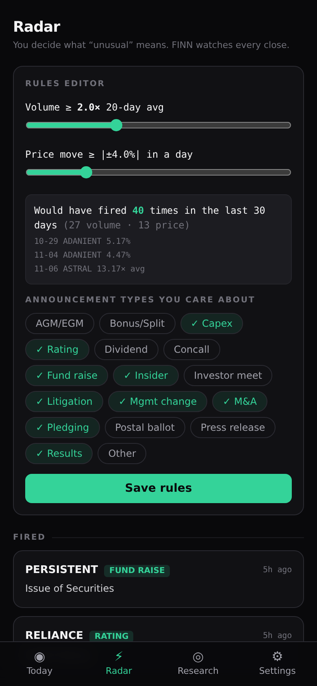
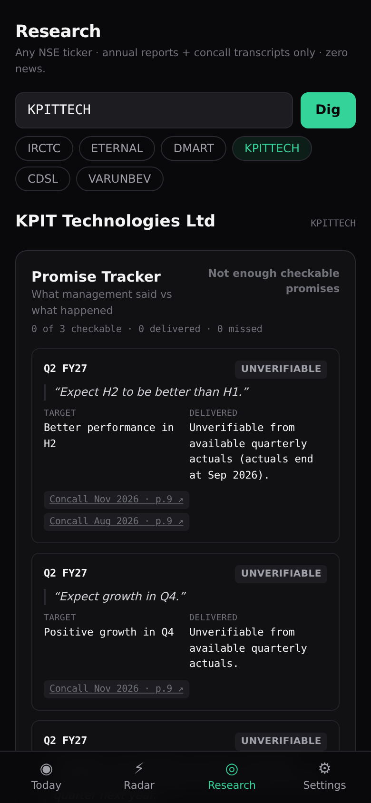

# FINN — Financial Investment Agent

> **Live:** https://finn-umber.vercel.app · **API:** https://finn-api-brw2.onrender.com/api/health
> First load may take ~50s — the API sleeps on Render's free tier; the app shows a "Waking FINN up…" state. Cold starts are the only wait; everything after is fast.

FINN is triage, not a feed. The first screen answers "is there anything I must act on?" in one sentence — material announcements surface with real renderings (results tables, sourced bios), routine filings are visibly buried, and on-demand research reads like an analyst's one-pager with receipts: every number opens the primary source at the cited page.

| Today — triage | Radar — your thresholds | Research — Promise Tracker |
|---|---|---|
|  |  |  |

## What it does

- **Push — windowed digest.** All NSE announcements across an 18-stock portfolio, any window (24h → 30d, custom). Rules-first classification (~70–87% handled free), MUST KNOW cards with real renderings — quarterly results (Revenue/EBITDA/PBT/PAT, QoQ/YoY, filing page refs) and management changes (sourced bios) — WORTH A LOOK rows, ROUTINE collapsed by category, tap anything for the filing PDF.
- **Push — Radar.** You define "unusual": volume ≥ N× 20-day average, price beyond ±X%, watched categories — each rule shows a live *"would have fired N times in 30 days"* backtest. Fired alerts plot the threshold line over the price/volume chart.
- **Pull — research.** Any NSE ticker (not just the demo set): FINN reads the annual report + last 4 concalls (whole documents, page-cited) and returns 8 sections plus the **Promise Tracker** — management's promises vs actual delivery, with a credibility score and verdict pills. Footer: "Built from N primary documents · 0 news · ₹0".

## Architecture

```
┌──────────── Vercel — Next.js PWA (dark/light) ─────────────┐
│  Today (triage) · Radar (thresholds) · Research · Settings │
└──────────────────────────┬─────────────────────────────────┘
                           │ JSON
┌──────────────────────────▼──────── Render free tier ───────┐
│  FastAPI · asyncio pipeline · SQLite (single file)         │
│  ├ ingest    NSE announcements (curl_cffi TLS-impersonated)│
│  ├ classify  rules/keywords first → cheap LLM leftovers    │
│  ├ enrich    results cards (cheap→strong, page-verified)   │
│  │           bios (filing text first, then Tavily)         │
│  ├ market    yfinance EOD → volume/price rules             │
│  └ research  screener docs → AR + 4 concalls → 8 sections  │
│              + Promise Tracker (citations validated)       │
│  LLM router: env-only models · llm_cache · cost ledger     │
│  snapshot restore on boot (NSE blocks most cloud IPs)      │
└────────────────────────────────────────────────────────────┘
```

## Model routing & cost (real numbers from the build ledger)

| Task | Route | Calls | Tokens in | Tokens out |
|---|---|---|---|---|
| Classify leftovers, extractions, bios | `gemini-3.5-flash-lite` | 84 (20 cached) | 568,254 | 40,236 |
| Research synthesis, results re-checks | `gemini-3.5-flash` | 16 (2 cached) | 76,244 | 27,042 |
| **Total** | | **100** | **644,498** | **67,278** |

Rules-first classification handled **70.2%** of a 30-day feed (87.5% of a 3-day set) with zero LLM cost; cache hit rate 22%. All arithmetic (QoQ/YoY/margins, derived EBITDA, numeric promise verdicts) is Python — never the model. Full ledger: `GET /api/admin/costs`.

## Data sources

- **NSE corporate announcements** — `curl_cffi` with Chrome TLS impersonation (plain clients get 403); 30-day windows; **BSE PDF host** as the filing-PDF fallback.
- **screener.in** — quarterly tables (the "actuals"), Documents section (annual reports + concall transcripts).
- **yfinance** — EOD bars (`.NS` → `.BO` fallback) for volume/price rules.
- **Gemini** (via our router, env-only model names) · **Tavily** (push-side bios only).
- **Primary-sources only** on the pull side: annual reports + transcripts. No news, no broker notes, no model outside-knowledge — every claim carries `{doc, period, page}` and uncited claims are dropped in code.

## Run locally

```bash
git clone https://github.com/OmThakre10047/finn && cd finn
(cd backend && pip install -r requirements.txt && cp .env.example .env && uvicorn app.main:app --port 8000 &)
cd frontend && npm install && npm run dev
```

`make refresh` — full pipeline + committed snapshot refresh · `make test` — 18-check pipeline test suite on real filings.

## Docs

`docs/PLAN.md` (architecture, schema, routing) · `docs/DECISIONS.md` (trade-offs, omissions, next steps) · `docs/PROGRESS.md` (full build log) · `docs/COVER_EMAIL.md` (submission note) · `ai-history/` (the complete agent session) · `docs/screens/` (design artifacts).
